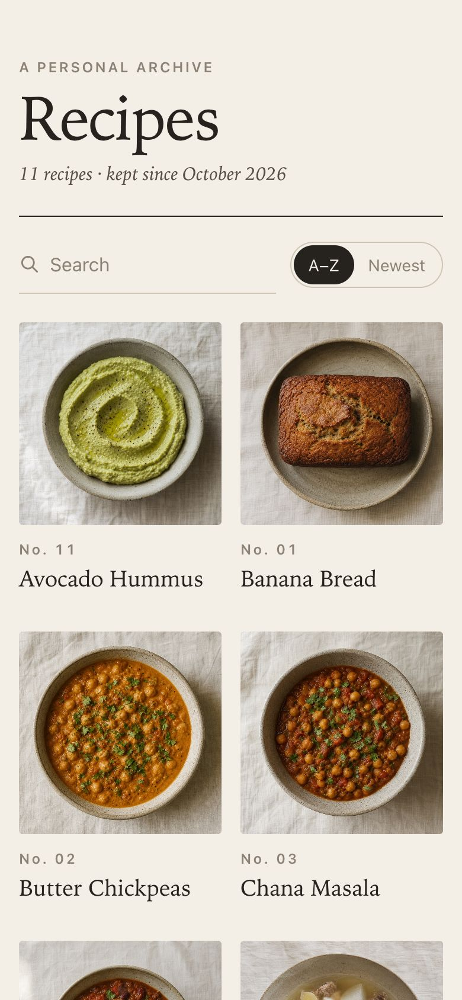
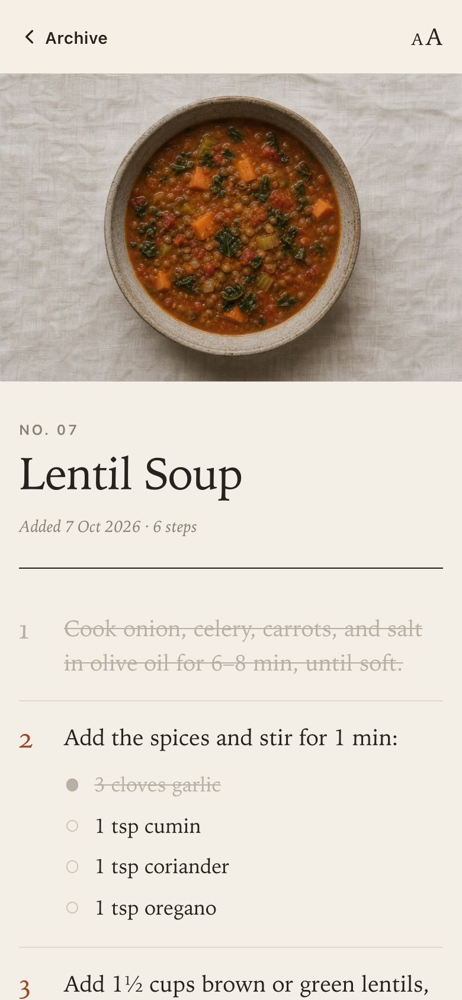
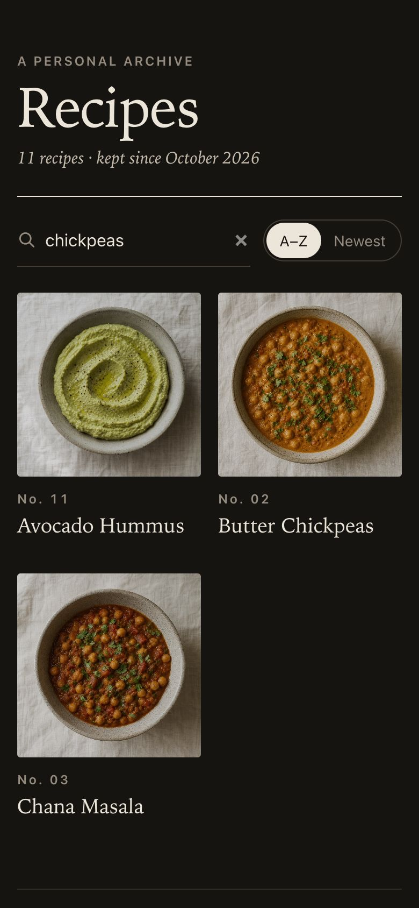
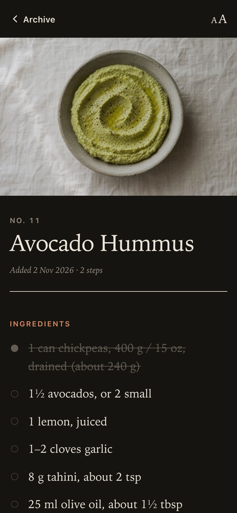

# Recipes

My recipe archive. Each recipe is a Markdown file, and the `recipe` script finds and shows them in the terminal. `recipes serve` also shows them as a website for reading on a phone in the kitchen.

<table>
  <tr>
    <td></td>
    <td></td>
    <td></td>
    <td></td>
  </tr>
  <tr>
    <td align="center">Browse</td>
    <td align="center">Cook and cross off</td>
    <td align="center">Search by ingredient</td>
    <td align="center">Dark mode</td>
  </tr>
</table>

## Setup

Add a `recipes` function to `~/.zshrc` so it works from any folder. On its own, `recipes` takes you to this folder. With anything after it, it runs the script:

```sh
recipes() {
  if [[ $# -eq 0 ]]; then
    cd /path/to/recipes
  else
    /path/to/recipes/recipe "$@"
  fi
}
```

For nicer formatting, install [glow](https://github.com/charmbracelet/glow). When several recipes match a name, [fzf](https://github.com/junegunn/fzf) lets you pick one from a list. Both are optional:

```sh
brew install glow fzf
```

## Usage

```sh
recipes                    # go to the recipes folder
recipes bread              # show a recipe (part of the name is enough)
recipes banana-bread.md    # file names work too
recipes new Chicken Curry  # start a new recipe from a template
recipes edit curry         # open a recipe in your editor
recipes search garlic      # list recipes that mention a word
recipes list               # list all recipes
recipes list --tag vegetarian   # list recipes with a tag
recipes tags               # list every tag and how many recipes use it
```

Each recipe has a tags line under its title, such as `Tags: indian, main, vegetarian, one-pot`. Tags cover cuisine, type of dish (main, side, soup, salad, dressing), diet (vegetarian, meat), and practical notes (quick, one-pot, make-ahead). Optional `Serves: 4` and `Time: 45 min` lines can follow the tags line; the website shows them and uses the serving count to scale amounts.

Inside the recipes folder, `./recipe` with nothing after it opens a pick-from-a-list menu with a preview.

## Website

`recipes serve` shows the archive as a website, so you can read recipes on your phone in the kitchen. It prints an address like `http://10.0.0.160:8000`. Open it on a phone on the same Wi-Fi. In Safari, tap Share → Add to Home Screen to get an app icon.

On the site you can:

- switch between the **Recipes** and **Salads** tabs. Salads has two sections, Salads and Dressings.
- search by dish or ingredient, and sort A–Z or newest first
- tap a tag, such as vegetarian or quick, to show only those recipes (tags also appear under each recipe's title, and tapping one there opens the filtered list)
- tap **Save** on a recipe, then tap **Saved** on the home page to see only your saved recipes
- change the servings with **−** and **+** to scale the ingredient amounts
- tap a time in a step, such as "12–15 minutes", to start a timer. Timers keep running while you move between pages, and beep and vibrate when they finish.
- tap **Add to shopping list** to collect ingredients from several recipes at `/list`, cross them off in the shop, and share or copy the list
- tap an ingredient or step to cross it off (each recipe remembers this until you tap Clear)
- tap **Print** for a clean printed page, or the **A A** button to make the text bigger
- see "Used in" on a dressing, which lists the salads that link to it

Saved recipes, the shopping list, and timers are stored in the browser on each device.

Pages are built from the Markdown files each time they load, so edits show up on refresh. The site uses only Python, with nothing to install. Its code is in `site/`.

## Photos

Each recipe has a photo in `images/<recipe>.jpg`, made with the OpenAI image API (`gpt-image-2`). Every photo uses the same art direction, so they look like a set.

```sh
recipes photos           # make photos for recipes that have none yet
recipes photos chili     # remake one recipe's photo
recipes photos --all     # remake every photo
```

The API key comes from `OPENAI_API_KEY`, or from the macOS keychain entry `openai-api-key`. You can also drop in your own photo as `images/<recipe>.jpg`.

When the display uses glow, it switches between light and dark themes to match macOS.
